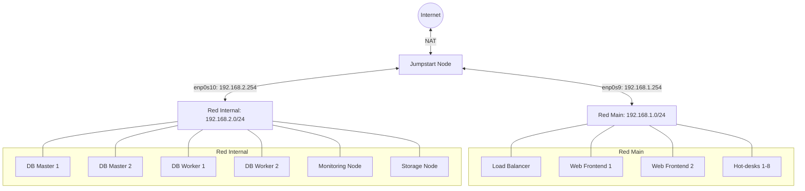

# Diagrama de Conexiones y Rutas (Fase 1: Aprovisionamiento)

## 1. Topología de Red

La infraestructura base se divide en dos segmentos principales (`main` e `internal`), orquestados durante esta fase inicial por el nodo Jumpstart. 
De acuerdo con los requisitos del diseño estructural, la red `internal` albergará los futuros nodos de base de datos y monitorización, mientras que la red `main` contendrá los frontales y puestos de empleado. En el estado actual (Baremetal), todas las máquinas han sido desplegadas a nivel de sistema operativo y conectadas a sus respectivos switches virtuales.

