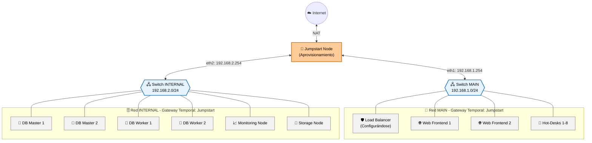
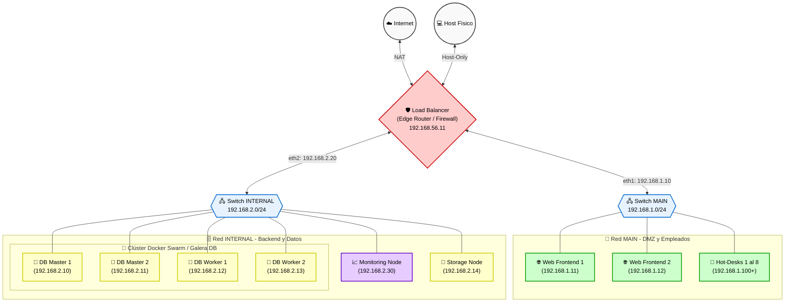

# Diagrama de Conexiones y Rutas

La topología de red se divide en dos fases lógicas bien diferenciadas: la **Fase 1 (Aprovisionamiento Baremetal)**, donde el orquestador y los servicios de red dependen temporalmente del nodo Jumpstart, y la **Fase 2 (Producción)**, donde la red se independiza y el enrutamiento se delega por completo en el Load Balancer (Bastión/Router), permitiendo apagar el Jumpstart de forma segura.

---

## 1. Fase 1: Aprovisionamiento (Jumpstart Activo)

Durante el despliegue inicial, el nodo Jumpstart se conecta a ambos segmentos de red internos para responder peticiones DHCP/PXE y dar salida temporal a internet a todos los nodos para su instalación.

### Diagrama de Conexiones en Fase 1



### Tabla de Direccionamiento y Rutas de Aprovisionamiento (Fase 1)

| Nodo | Interfaz | Red | Dirección IP | Gateway por Defecto | Permisos y Propósito |
| :--- | :--- | :--- | :--- | :--- | :--- |
| **Jumpstart** | `enp0s3`<br>`enp0s8`<br>`enp0s9`<br>`enp0s10` | NAT (VBox)<br>`vboxnet0`<br>`intnet_main`<br>`intnet_internal` | DHCP (Internet)<br>`192.168.56.10/24`<br>`192.168.1.254/24`<br>`192.168.2.254/24` | DHCP (Host)<br>—<br>—<br>— | **Servidor DHCP/TFTP (PXE)**. Proporciona enmascaramiento de red (NAT) y DNS a todos los nodos durante su instalación. |
| **Web Frontends / Hot-desks** | `enp0s3` | `intnet_main` | Asignada por DHCP / Estática | `192.168.1.254` | Acceso temporal a internet a través del Jumpstart para descargar paquetes y actualizaciones. |
| **Load Balancer** | `enp0s3`<br>`enp0s8`<br>`enp0s9`<br>`enp0s10` | `intnet_main`<br>NAT (VBox)<br>`intnet_internal`<br>`vboxnet0` | `192.168.1.10/24`<br>DHCP<br>`192.168.2.20/24`<br>`192.168.56.11/24` | `192.168.1.254` (temporal) | Conectividad con el Jumpstart para instalación de dependencias y Nginx. |
| **Nodos Internos (BD, ST, MN)** | `enp0s3` | `intnet_internal` | Asignada por DHCP / Estática | `192.168.2.254` | Acceso temporal a internet a través del Jumpstart para descargas requeridas durante el aprovisionamiento. |

---

## 2. Proceso de Transición: Relevo de Red (Lockdown)

El apagado del Jumpstart y la transición al modo de producción se realiza mediante la ejecución del **Rol 7 (Lockdown)** de Ansible. Este proceso realiza las siguientes acciones de forma automática:

1. **Reconfiguración de Interfaces (Netplan):**
   - En los nodos de la red `main` (Web Frontends y Hot-desks), se modifica el default gateway de `192.168.1.254` (Jumpstart) a `192.168.1.10` (Load Balancer).
   - En los nodos de la red `internal` (Bases de datos, Storage y Monitoring), se modifica el default gateway de `192.168.2.254` (Jumpstart) a `192.168.2.20` (Load Balancer).
2. **Aplicación de Red:** Se ejecuta `netplan apply` de manera asíncrona en todos los nodos para evitar desconexiones durante el cambio.
3. **Habilitación del Enrutamiento y Reglas en el Load Balancer:**
   - Se activa el redireccionamiento de paquetes en el kernel (`net.ipv4.ip_forward=1`).
   - Se aplican las reglas de enrutamiento e iptables definitivas en el Load Balancer (detalladas abajo).
4. **Apagado del Jumpstart:** La máquina virtual Jumpstart se apaga, dejando al Load Balancer como único router/bastión de la infraestructura.

---

## 3. Fase 2: Producción (Jumpstart Apagado)

Tras el relevo de red, la infraestructura es completamente autónoma. El Load Balancer gestiona el tráfico de entrada, salida y el aislamiento de subredes.

### Diagrama de Conexiones en Producción



### Tabla de Direccionamiento y Rutas de Producción

| Nodo | Interfaz | Red | Dirección IP | Gateway por Defecto | Permisos de Acceso |
| :--- | :--- | :--- | :--- | :--- | :--- |
| **Load Balancer** | `enp0s8`<br>`enp0s3`<br>`enp0s9`<br>`enp0s10` | NAT<br>`intnet_main`<br>`intnet_internal`<br>`vboxnet0` | DHCP<br>`192.168.1.10/24`<br>`192.168.2.20/24`<br>`192.168.56.11/24` | DHCP (Host)<br>—<br>—<br>— | Acceso total a internet, `main`, `internal` y al Host físico. Realiza NAT y reenvío de paquetes. |
| **Web Frontends** | `enp0s3` | `intnet_main` | `192.168.1.11/24`<br>`192.168.1.12/24` | `192.168.1.10` | Acceso a internet y a la red `internal` (enrutado por LB). |
| **Hot-desks** | `enp0s3` | `intnet_main` | `192.168.1.100/24` | `192.168.1.10` | Acceso a internet y a la red `internal` (enrutado por LB). |
| **BD Masters/Workers** | `enp0s3` | `intnet_internal` | `192.168.2.10/24` a `.13/24` | `192.168.2.20` | **Aislados de Internet**. Acceso exclusivo a la red `main` (enrutado por LB). |
| **Storage Node** | `enp0s3` | `intnet_internal` | `192.168.2.14/24` | `192.168.2.20` | **Aislado de Internet**. Acceso exclusivo a la red `main` (enrutado por LB). |
| **Monitoring Node** | `enp0s3` | `intnet_internal` | `192.168.2.30/24` | `192.168.2.20` | **Aislado de Internet**. Acceso exclusivo a la red `main` (enrutado por LB). |

### Configuración de Enrutamiento y NAT en el Load Balancer

El Load Balancer actúa como router/firewall a través de `iptables`. Las políticas y reglas clave aplicadas son:

1. **Activación de IP Forwarding:**
   ```bash
   sysctl -w net.ipv4.ip_forward=1
   ```
2. **NAT/Masquerade para la red `main` (Salida a Internet):**
   ```bash
   iptables -t nat -A POSTROUTING -s 192.168.1.0/24 -o enp0s8 -j MASQUERADE
   ```
   *Nota: No existe ninguna regla de enmascaramiento para `192.168.2.0/24`, por lo que las IPs internas nunca pueden salir enrutadas directamente a internet.*
3. **Reglas de Forwarding permitidas:**
   * **Retorno de tráfico:** Permite el flujo de conexiones ya establecidas o relacionadas (`-A FORWARD -m conntrack --ctstate ESTABLISHED,RELATED -j ACCEPT`).
   * **Internet para `main`:** Permite que `main` envíe tráfico al exterior a través de la interfaz NAT (`-A FORWARD -i enp0s3 -o enp0s8 -j ACCEPT`).
   * **Comunicación Inter-subnet (Req 7 y 8):** Permite el enrutamiento bidireccional directo entre ambas subredes (`-A FORWARD -i enp0s3 -o enp0s9 -j ACCEPT` y `-A FORWARD -i enp0s9 -o enp0s3 -j ACCEPT`).

---

## 4. Acceso de Administración desde el Host Físico

Para facilitar la administración, el Host físico puede comunicarse con el Load Balancer a través de la interfaz Host-Only `vboxnet0` usando la IP estática `192.168.56.11`. 

Si se desea acceder directamente a las subredes privadas `main` (`192.168.1.0/24`) e `internal` (`192.168.2.0/24`) desde la terminal del host sin usar túneles SSH, se deben añadir las siguientes rutas estáticas en la máquina física (Host):

```bash
# Añadir ruta a la red Main a través del Load Balancer
sudo ip route add 192.168.1.0/24 via 192.168.56.11

# Añadir ruta a la red Internal a través del Load Balancer
sudo ip route add 192.168.2.0/24 via 192.168.56.11
```
